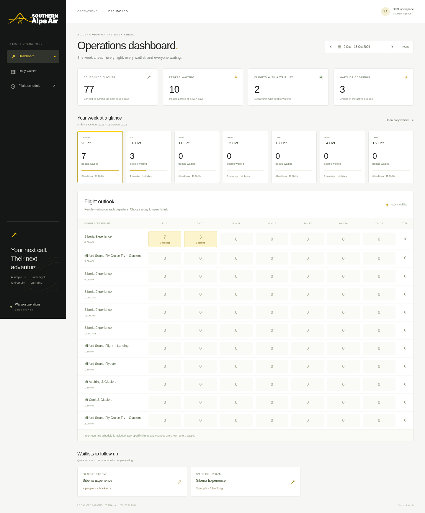

# Southern Alps Air flight waitlist

A staff workspace with a seven-day operations dashboard and ordered daily flight waitlists. Record the lead guest, number of people, and contact details for each waitlist booking. There is no capacity tracking, seat allocation, payment, or customer signup page.

## Run

For the **free website on a Windows computer**, see [browser website and local
saving](docs/browser-website.md). Open it in Chrome or Edge; the website saves
waitlists in that browser and receives updates through GitHub Pages. Full backup
and restore controls are included. The Python instructions below are for the
existing local app, including transferring old bookings to the browser edition.

Requires Python 3.12 or newer with the Pacific/Auckland time-zone database.

For a downloaded copy, unzip it, open a terminal in the extracted folder, and run
`python3 launch.py` on Mac/Linux or `py launch.py` on Windows. The launcher installs
dependencies on first use and opens the app in your default browser. Keep the
terminal open while working. Press Ctrl+C to close the app; saved waitlists remain
in the extracted folder's `instance/` directory. This local copy has its own lists;
it does not synchronise with the cloud environment or other computers.

For cloud development or a manual installation:

```sh
cd /workspace/SAA-Waitlist
python3 -m venv .venv
.venv/bin/python -m pip install -r requirements.txt
.venv/bin/gunicorn --bind 127.0.0.1:3000 --workers 1 --threads 4 'app:create_app()'
```

The app listens locally on port 3000. To run the Flask development server instead, use `.venv/bin/python app.py`.

## Update your Mac copy without losing waitlists

1. Stop the running app with Ctrl+C in its Terminal window.
2. Download the latest repository ZIP from GitHub and unzip it into a **new folder**. Keep the old app folder as a backup.
3. Before launching the new copy, **copy the entire `instance` folder** from the old app folder into the new one. It contains your database, schedule edits, and session key. If you have never added data or run the old copy, this folder may not exist.
4. In Terminal, type `python3` followed by a space, drag the **new folder's `launch.py`** into Terminal, and press Return.

The first run upgrades the copied database automatically. A backup named `waitlist.sqlite3.before-group-size.backup` is created before adding group sizes to an older database. Existing bookings default to one person; edit each booking to record its actual group size. No existing names, contacts, notes, queue order, archives, or schedule edits are reset.

If you configured `WAITLIST_DATABASE` to a custom location, it continues to select that database instead of the copied `instance` folder. Stop every app using that file before updating it.

## Week-ahead dashboard

- The app opens on **Dashboard**, showing seven days starting today in New Zealand time.
- The summary distinguishes **people waiting** from **waitlist bookings**. A booking for four people counts as one booking and four people.
- Day cards show waiting totals and departures. Choose a card to open that day's daily waitlist.
- **Flight outlook** shows waiting people for each departure across the seven days. Choose a cell to open that flight's list.
- **Waitlists to follow up** links to the first six departures in the selected period with active waitlists.
- Use the arrows to move forward/back by seven days, or the date picker to choose the first day. In Daily waitlist, those controls move one day at a time.

The outlook includes saved daily flights and previews the recurring schedule on days not yet opened. Viewing the dashboard does not create future daily snapshots or freeze the schedule. Archived bookings are excluded from all waiting totals.



The screenshot uses example test data, not customer records.

## Use the waitlist

- Select the operations date. “Today” uses New Zealand time.
- Choose **Add booking** from the dashboard or a daily flight list. Inside the form, use **Today**, **Tomorrow**, the seven date buttons, or the week arrows to choose the flight date. The calendar field also lets you jump directly to any date.
- Changing dates keeps the guest's name, group size, contact, and notes. The same scheduled departure stays selected when available on the new date; otherwise, choose a departure from that day's flights. The selected date is shown in full beneath the date buttons.
- Enter the lead guest and **number of people** (1–100); contact and notes are optional. Group size is not a flight-capacity limit. Saving opens the correct date and flight's waitlist.
- Each booking occupies one position in the queue. Use **↑ / ↓** to change the order. **Edit** can change group size and contact details or move the booking to another flight or date. A moved booking joins the end of the destination waitlist.
- **Archive** removes someone from the active queue. The Archived tab lets you restore them to the end of the list.
- **Flight details** changes a single day's flight name or time. **Add a flight** creates an extra departure just for that date.
- **Edit daily schedule** maintains recurring departures. Updates and removals affect days that have not yet been created. Existing daily flights and their waitlists are preserved. New recurring departures also appear when an already-created day is refreshed.
- **Export day** downloads that day's CSV, including archived records. Keep exports private.

The dashboard checks for updates every 30 seconds while visible and while no edit dialog is open. Updates save to SQLite immediately. There is no integration with your booking system, and no automatic email or SMS is sent.

## Flight schedule and branding

The 11 default daily departures in `default_schedule.json` were transcribed from the flight list supplied by the user, dated Friday 9 October 2026. They are used as the recurring schedule; staff can edit them. Multiple departures at 09:00 and 13:30 remain separate flights. Capacity, booking counts, day notes, and staffing details were not imported.

The black, white, and yellow theme follows the supplied Southern Alps Air logo. The displayed logo was reconstructed from the supplied screenshot to remove its hover tooltip; replace `static/images/southern-alps-air-logo.png` with an original logo asset if available. The website was inaccessible through the onboarding network policy, so no website-sourced branding is claimed.

## Data and staff access

The browser website stores data in the current browser profile using IndexedDB,
with no customer uploads or shared database. Download a full backup regularly.
Its public interface has no staff sign-in; access to records follows access to
that Windows account/browser profile. The settings below apply to the Python
edition.

Data lives in `instance/waitlist.sqlite3`; this directory is ignored by Git. Back up the database before changing machines. For a consistent backup while the app runs, use Python's SQLite backup API or SQLite's `.backup` command. Do not publish an onboarding snapshot containing actual customer data or distribute the session-key file.

`WAITLIST_DATABASE` selects a different persistent database file. The schedule is seeded once, so restarting does not reset it or overwrite edits. Restarting does not clear waitlists. Dates have separate lists.

Local use is supported without a password. For staff access from other machines, set `STAFF_PASSWORD` securely in the hosting environment and put the application behind HTTPS or a private network. Setting this variable enables the staff login for the dashboard, APIs, exports, and health endpoint. Do not put a password in source control. Set `COOKIE_SECURE=1` when serving through HTTPS.

For a protected deployment, run Gunicorn on your hosting platform's private interface and route requests through its HTTPS reverse proxy. The documented local command does not publish the app. Do not expose a password-free WSGI deployment to the internet. This version has one shared staff password, not individual staff accounts or an audit log.

CSV export is also available locally:

```sh
.venv/bin/flask --app app:create_app export-waitlist /tmp/saa-waitlist.csv --date 2026-10-09
```

The export command refuses to overwrite an existing file. Spreadsheet formula-like values are prefixed with an apostrophe. Archive retains customer information; permanently delete records through an authorised maintenance process when no longer needed.

## Validate

```sh
.venv/bin/python -m unittest discover -s tests -v
.venv/bin/python -m pip check
```

The automated suite covers persistence, day/flight isolation, queue order, archive/restore, group-size validation and exports, migrating an older database, moving and editing entries, simultaneous additions, schedule changes, seven-day totals, schedule previews, exports, CSRF, and staff authentication. Tests use temporary databases; they do not add customers to the operating database.

The Pages workflow also runs the real-browser checks described in the
[browser website guide](docs/browser-website.md) before publishing.
